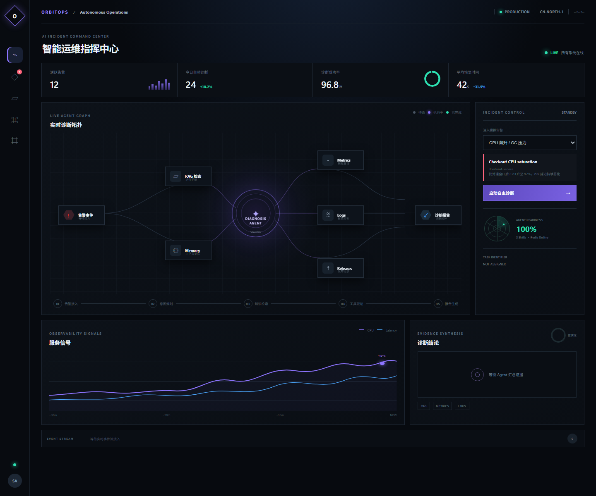
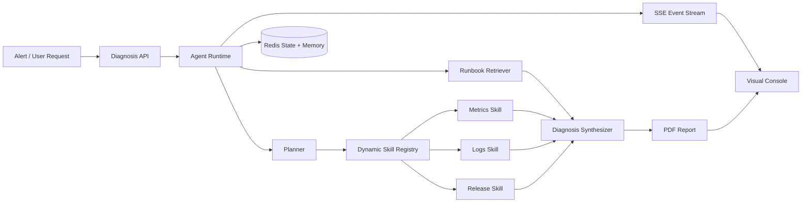
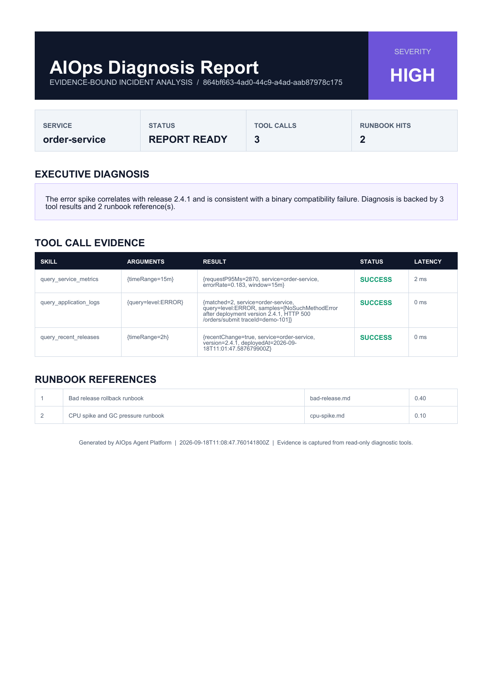

# AIOps Agent Platform


一个证据驱动的智能运维 Agent 平台：接收服务告警，检索排障知识，通过动态
Skill 调用采集指标、日志和发布记录，将状态与调用轨迹持久化到 Redis，并通过
SSE 实时推送诊断过程，最终生成可审计的 PDF 报告。

默认使用确定性 Mock Planner，**不配置模型 Key 也能完整运行**；需要连接真实
大模型时，可以启用 Spring AI 的 `llm` Profile。



## 项目解决的问题

传统线上排障通常需要人工在监控、日志、发布平台和运维手册之间反复切换：

- 告警信息分散，定位过程依赖个人经验；
- 大模型可能给出没有观测证据支持的结论；
- Tool 调用过程不可见，发生误判后难以审计；
- 长任务断线或应用重启后，诊断上下文容易丢失。

本项目使用“规划 - 检索 - 取证 - 推理 - 报告”闭环解决这些问题。最终结论必须
引用 RAG 文档和只读 Tool 的真实返回值；任务状态、Memory、Tool Calling 和事件
流均可持久化、查询与重放。

## 系统架构



核心模块边界和状态机说明见 [Architecture](docs/ARCHITECTURE.md)。

## 一条完整的 Agent 执行链

以 `bad_release` 场景为例，实际运行产生 42 个可重放事件：

```text
HIGH 告警进入
  -> 创建异步诊断任务
  -> Planner 生成 3 个 Skill 的执行计划
  -> RAG 命中 2 份 Runbook
  -> query_service_metrics：错误率 18.3%，P95 2870 ms
  -> query_application_logs：发现 NoSuchMethodError 与 HTTP 500
  -> query_recent_releases：发现 2.4.1 为近期变更
  -> Synthesizer 将证据关联到发布异常
  -> Memory 写入 RAG_EVIDENCE 与 DIAGNOSIS
  -> SSE 流式推送模型 Token 和 Tool 进度
  -> 生成 PDF 报告并进入 COMPLETED
```

完整的机器可读运行样例见
[bad-release-run.json](docs/examples/bad-release-run.json)。

## 动态 Skills

Skill 使用 Markdown + YAML Front Matter 声明名称、描述、参数 Schema、风险等级、
超时和受信任 Handler。`DynamicSkillRegistry` 在启动时完成解析、校验和原子替换，
并通过 Spring AI `ToolCallbackProvider` 暴露为模型可调用工具。Markdown 本身不能
执行代码。

| Skill | 输入 | 用途 | 定义 |
| --- | --- | --- | --- |
| `query_service_metrics` | `timeRange` | 查询饱和度、错误率和延迟 | [Markdown](skills/query-service-metrics.md) |
| `query_application_logs` | `query` | 查询错误日志和代表性样本 | [Markdown](skills/query-application-logs.md) |
| `query_recent_releases` | `timeRange` | 查询近期发布版本并进行时间关联 | [Markdown](skills/query-recent-releases.md) |

示例定义：

```yaml
name: query_recent_releases
description: Query recent deployments for the affected service
version: 1.0.0
riskLevel: READ_ONLY
handler: queryReleasesHandler
timeoutMs: 3000
parameters:
  timeRange:
    type: string
    required: true
```

## 排障 SOP / Runbooks

| SOP | 关键步骤 | 文件 |
| --- | --- | --- |
| 异常版本回滚 | 对齐错误率与发布时间，确认最后正常版本，回滚前要求审批 | [bad-release.md](runbooks/bad-release.md) |
| 数据库连接池耗尽 | 对比活跃连接与上限，检查获取超时和慢查询，避免盲目重启 | [connection-pool.md](runbooks/connection-pool.md) |
| CPU 与 GC 压力 | 对比 CPU、负载、P99 和 GC 日志，保留线程栈后再处理 | [cpu-spike.md](runbooks/cpu-spike.md) |

## RAG 检索结果

下面是 `bad_release` 实际运行时写入 Agent Memory 的检索证据：

```json
{
  "category": "RAG_EVIDENCE",
  "summary": "Retrieved 2 relevant runbook(s)",
  "documents": [
    {
      "documentId": "bad-release.md",
      "title": "Bad release rollback runbook",
      "score": 0.4
    },
    {
      "documentId": "cpu-spike.md",
      "title": "CPU spike and GC pressure runbook",
      "score": 0.1
    }
  ]
}
```

离线演示采用确定性检索器，保证任何机器都能复现；`RunbookRetriever` 接口可以在
不修改 Agent Runtime 的情况下替换为向量数据库实现。

## Tool Calling 记录

每次 Tool 调用都会记录输入、结果、耗时与成功状态。一次真实演示的精简结果如下：

| Tool | Arguments | Evidence | Status |
| --- | --- | --- | --- |
| `query_service_metrics` | `timeRange=15m` | `errorRate=0.183`, `requestP95Ms=2870` | SUCCESS |
| `query_application_logs` | `query=level:ERROR` | `NoSuchMethodError`, `HTTP 500` | SUCCESS |
| `query_recent_releases` | `timeRange=2h` | `version=2.4.1`, `recentChange=true` | SUCCESS |

完整审计信息可在运行时查询：

```http
GET /api/diagnoses/{taskId}/audit
```

Redis Profile 分别持久化：

```text
aiops:task:{taskId}:state       当前任务快照
aiops:task:{taskId}:version     乐观版本号
aiops:task:{taskId}:events      可重放 SSE 事件
aiops:task:{taskId}:memory      RAG 证据与诊断摘要
aiops:task:{taskId}:tool-calls  Tool 输入、输出、耗时与状态
```

任务快照通过 Lua 脚本原子校验版本，防止旧规划结果覆盖新状态。

## 最终诊断报告

诊断结论：错误峰值与 `2.4.1` 发布高度相关，日志中的 `NoSuchMethodError` 指向
二进制兼容性问题；该结论由 3 次 Tool 调用和 2 份 Runbook 共同支撑。

[下载真实运行生成的示例 PDF](docs/sample-diagnosis-report.pdf)



## SSE 实时事件流

```http
GET /api/diagnoses/{taskId}/events
Last-Event-ID: 12
```

同一个连接会推送任务状态、RAG 命中、Tool 开始/完成、模型 Token、报告地址和
最终结果。事件拥有单任务递增 ID，支持 `Last-Event-ID` 断线重放、心跳和终态清理。
PDF 二进制通过独立下载接口传输，不塞入 SSE。

## 快速启动

要求 Java 17 和 Maven 3.9+。默认 `local` Profile 使用内存 Repository 和 Mock
Planner，不需要 Redis 或模型 Key。

```powershell
git clone <your-repository-url>
cd aiops-agent-platform
mvn -s .mvn/settings.xml test
mvn -s .mvn/settings.xml package -DskipTests
java -jar target/aiops-agent-platform-0.1.0-SNAPSHOT.jar
```

浏览器打开 [http://localhost:8080](http://localhost:8080)，选择故障场景并点击
“启动自主诊断”。

### Docker + Redis

```powershell
docker compose up --build
```

该方式启用 `redis` Profile。应用重启后，任务状态、Memory、Tool Calling 和 SSE
事件仍然可查询。停止环境但保留数据：

```powershell
docker compose stop
```

## 可选：连接真实大模型

复制 `.env.example` 并设置 OpenAI-compatible 服务。不要把 `.env` 或 Key 提交到
Git。默认离线演示不依赖该配置。

```powershell
$env:SPRING_PROFILES_ACTIVE='redis,llm'
$env:OPENAI_API_KEY='...'
$env:OPENAI_BASE_URL='https://api.openai.com'
$env:OPENAI_MODEL='gpt-4.1-mini'
java -jar target/aiops-agent-platform-0.1.0-SNAPSHOT.jar
```

## API 示例

```http
POST /api/diagnoses
Content-Type: application/json

{
  "title": "Order API error spike",
  "service": "order-service",
  "severity": "HIGH",
  "description": "Error rate increased immediately after deployment",
  "labels": {"scenario": "bad_release"}
}
```

内置故障场景包括 `cpu_spike`、`connection_pool` 和 `bad_release`。

## 测试结果

```text
Tests run: 1, Failures: 0, Errors: 0 - DiagnosisWorkflowIntegrationTest
Tests run: 1, Failures: 0, Errors: 0 - MarkdownSkillParserTest
Total: 2 tests, 0 failures, 0 errors
```

```powershell
mvn -s .mvn/settings.xml test
docker compose config --quiet
```

测试覆盖：

- Markdown Skill 解析和 Schema 校验；
- 完整的规划、RAG、三次 Tool 调用和 PDF 生成；
- Agent Memory、Tool Calling 和事件审计；
- Redis Profile 应用重启后的状态恢复已人工验证。

仓库包含 GitHub Actions 工作流，每次 Push 和 Pull Request 都会在 Java 17 下执行
测试、打包和 Compose 配置校验。

## 设计边界

- 所有演示 Tool 都是只读工具，不自动执行重启、扩容或回滚；
- 高风险变更应增加审批节点、RBAC、幂等控制和审计签名；
- Mock Planner 与模拟观测数据用于可复现演示，不冒充真实生产监控数据；
- `llm` Profile 是可选适配层，未配置时不影响端到端链路运行。

## 文档

- [系统架构](docs/ARCHITECTURE.md)
- [完整运行样例](docs/examples/bad-release-run.json)
- [面试讲解手册](docs/INTERVIEW_GUIDE.md)
- [实施与验证记录](IMPLEMENTATION_STATUS.md)
- [示例诊断报告](docs/sample-diagnosis-report.pdf)

## License

[MIT](LICENSE)
